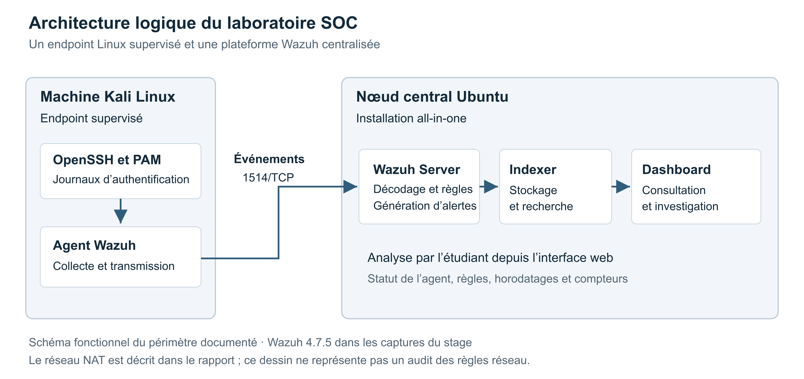
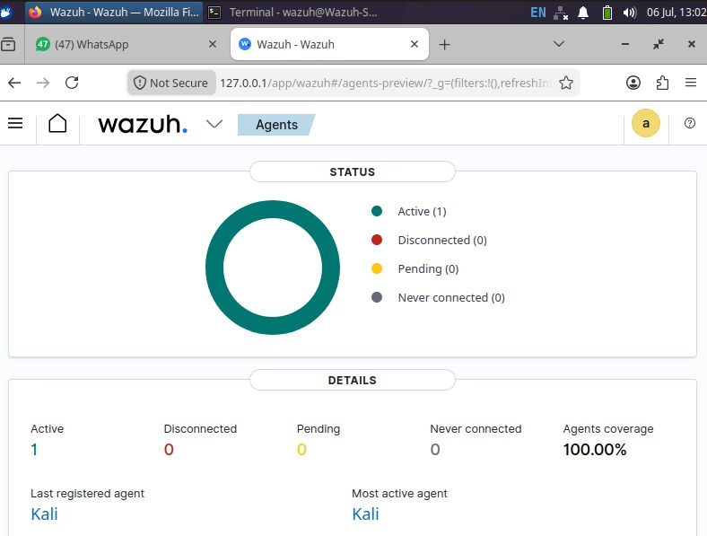
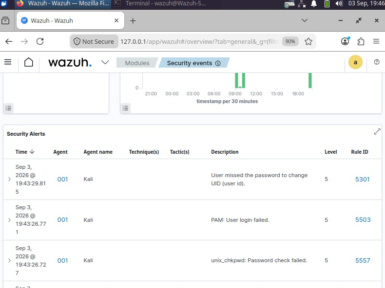
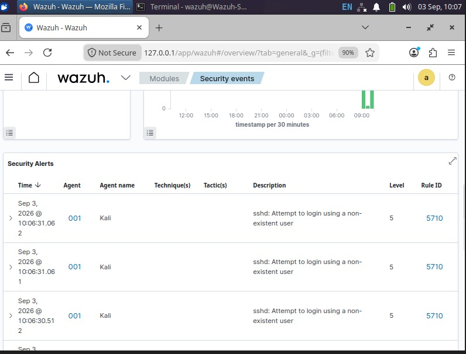
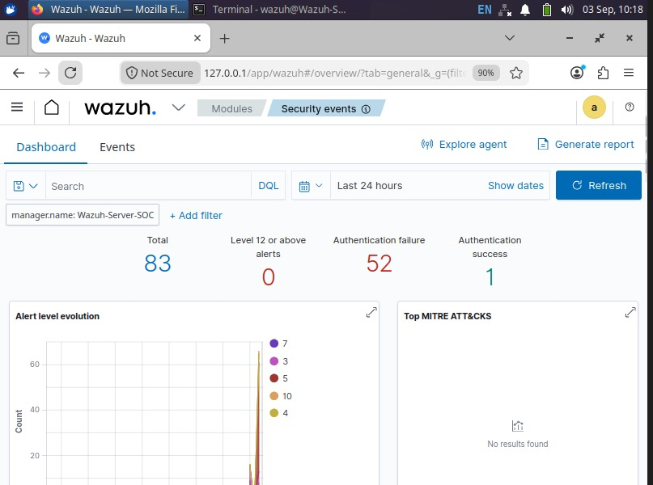

# Supervision SOC avec Wazuh

Déploiement d’un SIEM, collecte de journaux Linux et analyse d’échecs d’authentification.

Dans le cadre de mon stage technique de quatrième année en Ingénierie des Réseaux et Cybersécurité, j’ai mis en place un laboratoire Wazuh pour suivre les événements d’une machine Linux. Je souhaitais comprendre comment une action sur un poste devient un journal, puis une alerte exploitable par un analyste SOC.

J’ai déployé les composants centraux sur Ubuntu, enrôlé un agent Kali Linux et étudié les événements générés par des tests d’authentification locaux. Ce dépôt présente mon travail, les captures retenues et l’interprétation des résultats.

**Auteur :** [Otmane Arajdal](https://github.com/xxxotmane) · **Contexte :** stage technique de 4e année · **Période :** juillet à septembre 2026.

[Synthèse publique du projet](docs/synthese-projet.pdf) · [Scénarios de validation](docs/scenarios-validation.md) · [Analyse des résultats](docs/analyse-resultats.md) · [Démarche de déploiement](docs/deploiement.md)

## Ce que j’ai réalisé

- Préparation du laboratoire virtuel et vérification de la connectivité entre les machines.
- Installation du Wazuh Server, de l’Indexer et du Dashboard sur le nœud central.
- Installation et enrôlement de l’agent sur Kali Linux, puis vérification de son état actif.
- Préparation de tests contrôlés d’authentification locale et SSH.
- Lecture des alertes, identification des règles déclenchées et analyse des événements dans le Dashboard.
- Diagnostic de difficultés d’installation liées à la gestion des paquets et à des configurations résiduelles.

Il s’agit d’une maquette de supervision, réalisée dans un environnement de test. Je ne présente pas ce travail comme l’exploitation d’un SOC d’entreprise en production.

## Architecture du laboratoire



Le nœud Ubuntu regroupe les trois composants centraux dans une installation **all-in-one**. La machine Kali est l’endpoint supervisé et sert également aux tests locaux. Le schéma décrit le chemin logique des événements ; les détails du réseau et des ports sont présentés dans [la documentation d’architecture](docs/architecture.md).

| Élément | Utilisation dans le projet |
|---|---|
| Ubuntu 22.04 LTS | Hébergement de la plateforme centrale |
| Wazuh 4.7.5 | Version visible dans les captures d’installation ; analyse et visualisation des événements |
| Wazuh Agent 4.7.5 | Collecte des événements sur Kali Linux |
| Kali Linux | Endpoint supervisé et environnement de tests |
| OpenSSH et PAM | Sources des événements d’authentification étudiés |
| Hydra 9.6 | Génération de tentatives SSH contrôlées sur la boucle locale |

Ces versions décrivent l’environnement historique du stage. Pour reconstruire un laboratoire aujourd’hui, il faut vérifier les versions maintenues et leurs instructions officielles.

## Déploiement et validation de l’agent

J’ai utilisé l’assistant officiel `wazuh-install.sh` pour installer le nœud central. Depuis le Dashboard, j’ai ensuite préparé l’enrôlement de l’agent Linux, configuré l’adresse du Manager et démarré le service sur Kali.



La capture montre **un agent actif**. La couverture affichée de 100 % concerne cet unique agent connu du laboratoire ; elle ne mesure pas l’efficacité globale de la détection.

## Scénarios étudiés

| Scénario | Action réalisée | Observation | Interprétation |
|---|---|---|---|
| Authentification locale | Tentatives `su root` depuis un compte de test | Événements PAM et `unix_chkpwd`, règles 5301, 5503 et 5557 de niveau 5 | Les échecs sont remontés et catégorisés ; aucune élévation de privilèges réussie n’est démontrée. |
| Authentification SSH | Test Hydra vers `127.0.0.1`, avec un utilisateur de test inexistant | Le test visible ne trouve aucun mot de passe valide ; le Dashboard montre des événements SSH de règle 5710 | La règle signale un utilisateur inexistant. Elle ne prouve pas, à elle seule, une détection corrélée de brute force. |



*Échecs d’authentification visibles dans le Dashboard. Le niveau 5 est le niveau de règle observé, pas une qualification d’incident critique.*



*La règle 5710 porte sur les tentatives SSH utilisant un utilisateur inexistant. Les détails des tests sont expliqués dans les scénarios de validation.*

## Résultats et portée des observations

La vue agrégée capturée sur **24 heures** présente **83 événements au total**, dont **52 échecs d’authentification** et **1 succès d’authentification**. Ces catégories ne représentent pas l’ensemble des événements.



Ces compteurs correspondent à la fenêtre et au filtre affichés. Ils ne permettent pas d’attribuer chaque événement à une seule exécution Hydra, ni de calculer un taux de détection. La capture de synthèse et les tests PAM du soir sont des observations distinctes. Le succès affiché n’est pas une preuve de réussite du test offensif.

Le résultat principal est la validation de la chaîne de supervision : l’agent est connecté et des événements d’authentification sont consultables dans le Dashboard. La lecture des horodatages, des descriptions et des identifiants de règles reste nécessaire pour qualifier une alerte.

## Limites et pistes d’amélioration

Je n’ai pas mesuré de latence de détection, évalué un taux de faux positifs ni démontré une réponse automatique. Les captures ne valident pas non plus une campagne FIM, une couverture NIDS ou un audit de vulnérabilités complet.

Les suites possibles seraient de valider une règle de corrélation pour les tentatives répétées, d’ajouter un endpoint Windows, de tester la surveillance d’intégrité des fichiers et de structurer le suivi des incidents. L’automatisation par API et l’intégration à un outil de ticketing restent des perspectives.

## Documentation disponible

```text
wazuh-soc-lab/
├── README.md
├── .gitignore
├── GITHUB_SETUP.md
├── assets/
│   ├── architecture.png
│   ├── architecture.svg
│   └── captures sélectionnées
├── docs/
│   ├── synthese-projet.pdf
│   ├── architecture.md
│   ├── deploiement.md
│   ├── scenarios-validation.md
│   ├── analyse-resultats.md
│   └── sources-et-preuves.md
└── results/
    ├── observations.csv
    └── summary.json
```

La synthèse publique reprend les éléments techniques du projet. Le rapport de stage original et les captures de génération d’accès administrateur ne sont pas redistribués. Aucun script personnel ni règle personnalisée n’est annoncé comme livré, car ces fichiers ne font pas partie des éléments disponibles.

## Ce que je retiens

Ce projet m’a appris à suivre un événement depuis le poste supervisé jusqu’à son affichage dans le SIEM. J’ai aussi appris à lire une alerte selon sa règle et son contexte : voir plusieurs échecs d’authentification ne suffit pas à conclure à une compromission. Ce travail constitue une première expérience pratique de collecte, de supervision et d’analyse dans une démarche Blue Team.

## Références

- [Architecture officielle Wazuh](https://documentation.wazuh.com/current/getting-started/architecture.html)
- [Installation des composants centraux](https://documentation.wazuh.com/current/quickstart.html)
- [Classification des niveaux de règles](https://documentation.wazuh.com/current/user-manual/ruleset/rules/rules-classification.html)
- [Code source des règles SSH](https://github.com/wazuh/wazuh/blob/master/ruleset/rules/0095-sshd_rules.xml)
- [Traçabilité des observations du projet](docs/sources-et-preuves.md)
